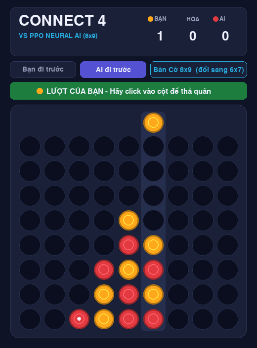
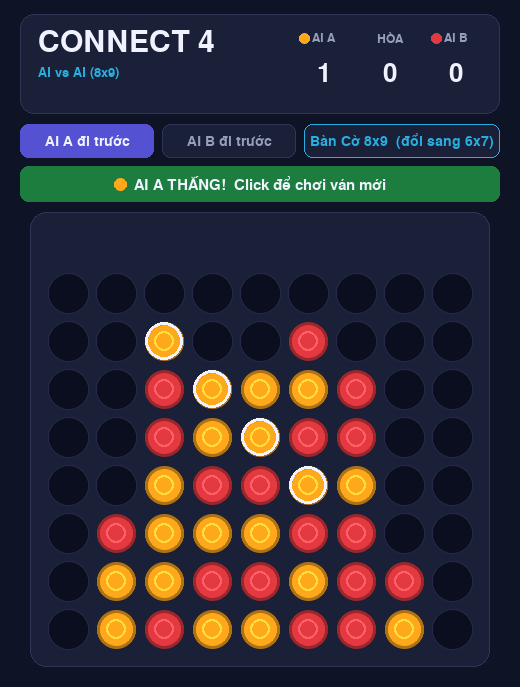

# Connect 4 AI - Strategy Arena

Trò chơi **Connect 4 (Bốn quân thẳng hàng)** trên bàn **8 hàng × 9 cột** (hỗ trợ cả bàn cổ điển 6×7), kèm AI được huấn luyện bằng **học tăng cường (MaskablePPO + self-play)** và giao diện đồ hoạ `pygame`.

<p align="center">
  
  &nbsp;&nbsp;
  
</p>

## Mục lục

1. [Tính năng](#1-tính-năng)
2. [Cấu trúc dự án](#2-cấu-trúc-dự-án)
3. [Yêu cầu hệ thống](#3-yêu-cầu-hệ-thống)
4. [Cài đặt](#4-cài-đặt)
5. [Chạy nhanh](#5-chạy-nhanh) · [**Thang 8 cấp độ**](#thang-8-cấp-độ)
6. [Hướng dẫn chơi](#6-hướng-dẫn-chơi)
7. [Huấn luyện AI](#7-huấn-luyện-ai)
8. [Đánh giá model](#8-đánh-giá-model)
9. [Kết quả](#9-kết-quả)
10. [Cách hoạt động](#10-cách-hoạt-động)
11. [Xử lý sự cố](#11-xử-lý-sự-cố)
12. [Hạn chế và hướng phát triển](#12-hạn-chế-và-hướng-phát-triển)

---

## 1. Tính năng

- **Bàn cờ tuỳ chọn:** mặc định 8×9, đổi sang 6×7 bằng một tham số hoặc một nút bấm trong game.
- **5 chế độ chơi:** Người vs Random, Tactical, Minimax, AI đã train, và **AI vs AI** (xem đấu).
- **Giao diện Arena:** nền tối, bảng điểm BẠN / HÒA / AI, chọn ai đi trước, cột sáng + quân ma khi rê chuột, quân rơi có hiệu ứng, viền sáng 4 quân thắng.
- **AI mạnh hơn bản cũ rõ rệt:** thắng toàn bộ 16 agent PPO của phiên bản đầu (xem [Kết quả](#9-kết-quả)).
- **Lõi luật bitboard** nhanh và đã kiểm thử với brute-force; minimax alpha-beta độ sâu 8 chỉ ~0.1 giây.
- **Huấn luyện tái lập được:** self-play có bể đối thủ, đánh giá định kỳ, lưu CSV và TensorBoard, hỗ trợ `--resume`.

## 2. Cấu trúc dự án

```
connect4_v2/
├── play.py              # Điểm vào: menu 1-5 hoặc --mode ...
├── gui.py               # Giao diện pygame (do play.py gọi)
├── levels.py            # Thang 8 cấp độ (registry + tạo người chơi theo cấp)
├── mcts.py              # Cấp 4 (Monte Carlo), cấp 5 (giám sát), cấp 7-8 (AlphaZero)
├── train_levels.py      # Train cấp 5-8 (mặc định 10.000 bước mỗi cấp)
├── evaluate_levels.py   # Đo sức mạnh thang 8 cấp
├── c4core.py            # Luật bàn cờ (bitboard), minimax, các người chơi mẫu
├── c4env.py             # Môi trường Gymnasium + bể đối thủ self-play
├── train_v2.py          # Huấn luyện MaskablePPO
├── evaluate_v2.py       # Đánh giá model với các đối thủ cố định
├── test_core.py         # Kiểm thử lõi luật (bitboard, minimax)
├── test_regression.py   # Kiểm thử hồi quy các lỗi đã sửa (model, seed, biên cột...)
├── CHANGELOG.md         # Danh sách thay đổi / lỗi đã sửa
├── .gitignore
├── requirements.txt
├── levels/8x9/          # Model các cấp 5, 6, 7-8 (+ log train)
├── models/
│   ├── agent_8x9.zip    # AI cho bàn 8x9 (mặc định)
│   └── agent_6x7.zip    # AI cho bàn 6x7
├── results/             # Kết quả thí nghiệm (CSV + experiments.md)
└── docs/                # Ảnh chụp giao diện
```

## 3. Yêu cầu hệ thống

| Thành phần | Yêu cầu |
|---|---|
| Python | **3.10 trở lên** (dùng `int.bit_count()`) |
| Hệ điều hành | Windows / Linux / macOS |
| Phần cứng | CPU là đủ; không cần GPU |
| Màn hình | Cao tối thiểu ~700 px ở bàn 8×9 (hoặc dùng `--cell` để thu nhỏ) |

## 4. Cài đặt

**Windows (PowerShell):**

```powershell
cd connect4_v2
python -m venv venv
.\venv\Scripts\Activate.ps1
pip install -r requirements.txt
```

**Linux / macOS:**

```bash
cd connect4_v2
python3 -m venv venv
source venv/bin/activate
pip install -r requirements.txt
```

Kiểm tra cài đặt (mọi dòng phải báo OK / PASS):

```bash
python test_core.py          # luật bàn cờ + minimax (vài giây)
python test_regression.py    # model lưu/nạp, seed, biên cột... (16 kiểm thử)
```

## 5. Chạy nhanh

```bash
python play.py
```

Menu hiện ra:

```
==========================================
     CONNECT 4 (8x9) - AI MENU
==========================================
1. Human vs Random
2. Human vs Tactical (thắng/chặn nước 1)
3. Human vs Minimax
4. Human vs trained agent
5. Agent vs Agent (xem đấu)
6. Human vs Level 1-8 (thang độ khó)
0. Exit
```

Vào thẳng một chế độ (bỏ qua menu):

| Mục đích | Lệnh |
|---|---|
| Đấu AI đã train (bàn 8×9) | `python play.py --mode agent` |
| Đấu Minimax độ sâu 4 | `python play.py --mode minimax --depth 4` |
| Đấu bot Tactical | `python play.py --mode tactical` |
| Đấu Random | `python play.py --mode random` |
| **AI + tìm kiếm (mạnh hơn nhiều)** | `python play.py --mode agent --search 4` |
| **Thang 8 cấp độ** (phím 1-8 đổi cấp trong game) | `python play.py --level 5` |
| Xem hai AI đấu nhau | `python play.py --mode aivai` |
| Bàn 6×7 cổ điển | `python play.py --rows 6 --cols 7` |
| Dùng model riêng | `python play.py --mode agent --model runs/main/best.zip` |
| Thu nhỏ cửa sổ | `python play.py --cell 44` |

### Tham số của `play.py`

| Tham số | Mặc định | Ý nghĩa |
|---|---|---|
| `--mode` | (hiện menu) | `random`, `tactical`, `minimax`, `agent`, `aivai`, `level` |
| `--level` | - | Cấp độ 1-8 (tự vào mode `level`) |
| `--depth` | 4 | Độ sâu minimax (1-8) |
| `--search` | 0 | Chế độ lai: minimax độ sâu N loại các nước dẫn tới thế thua (khuyến nghị 4; menu mặc định hỏi 4) |
| `--model` | `models/agent_<R>x<C>.zip` (tuyệt đối) | Đường dẫn model AI |
| `--model-b` | = `--model` | Model của AI B (mode `aivai`) |
| `--rows`, `--cols` | 8, 9 | Kích thước bàn |
| `--cell` | 0 (tự động) | Cỡ ô tính bằng pixel |

## Thang 8 cấp độ

Chơi: `python play.py --level 5` (hoặc menu mục 6). **Trong game bấm phím `1`–`8` để đổi cấp** (bảng điểm được đặt lại).

<p align="center"></p>

| Cấp | Phương pháp | Cần train | Mô tả |
|---|---|---|---|
| 1 | Random | không | Đi ngẫu nhiên |
| 2 | Heuristic | không | Chấm điểm bàn cờ sau 1 nước; thắng/chặn ngay; không tặng thắng |
| 3 | Minimax | không | Negamax + alpha-beta, độ sâu 3 |
| 4 | Monte Carlo | không | MCTS thuần (UCT + ván giả lập ngẫu nhiên), 4000 mô phỏng |
| 5 | Học có giám sát | có | Mạng MLP bắt chước nước đi của minimax độ sâu 4 |
| 6 | Học tăng cường | có | MaskablePPO, khởi tạo từ mạng cấp 5 rồi tự chơi |
| 7 | AlphaZero | có | Mạng policy+value + MCTS PUCT, **100** mô phỏng/nước |
| 8 | AlphaZero | có | Cùng mạng với cấp 7, **800** mô phỏng/nước |

### Train các cấp (10.000 bước mỗi cấp)

```bash
python train_levels.py                        # cấp 5, 6, 7(+8): 10.000 bước mỗi cấp
python train_levels.py --levels 5             # chỉ một cấp
python train_levels.py --steps 50000          # ngân sách lớn hơn (mạnh hơn, lâu hơn)
python train_levels.py --max-seconds 240      # chia nhỏ: chạy lại đúng lệnh để TIẾP TỤC
```

"Bước" mỗi cấp được tính khác nhau (nói rõ để so sánh công bằng):

| Cấp | 1 bước là | Dữ liệu / tự chơi |
|---|---|---|
| 5 | 1 lần cập nhật gradient (batch 128) | 60.000 thế cờ do minimax d4 gán nhãn, tăng cường bằng lật gương |
| 6 | 1 bước môi trường PPO (10 lần cập nhật chính sách) | Tự chơi với bể đối thủ; bắt đầu từ mạng cấp 5 (`--rl-scratch` để khởi tạo ngẫu nhiên) |
| 7-8 | 1 lần cập nhật gradient | ~2.000 ván tự chơi, 64 mô phỏng/nước, buffer 60.000 mẫu |

Máy 1 CPU: cấp 5 ~10 phút (chủ yếu sinh dữ liệu), cấp 6 ~15 giây, cấp 7-8 ~7 phút. Đo sức mạnh: `python evaluate_levels.py --games 20`.

### Sức mạnh đo được (bàn 8×9, 20 ván mỗi ô, điểm = thắng + 0,5·hoà)

| Cấp | vs Random | vs Minimax d2 | vs Minimax d4 | vs cấp dưới |
|---|---|---|---|---|
| 1 Random | 0,40 | 0,00 | 0,00 | - |
| 2 Heuristic | 1,00 | 0,25 | 0,10 | 1,00 |
| 3 Minimax | 1,00 | 0,50 | 0,45 | 0,85 |
| 4 Monte Carlo | 1,00 | 0,75 | 0,70 | 0,60 |
| 5 Học có giám sát | 1,00 | 0,50 | 0,17 | 0,10 |
| 6 Học tăng cường | 1,00 | 0,25 | 0,15 | 0,45 |
| 7 AlphaZero (100) | 1,00 | 0,55 | 0,25 | 0,75 |
| 8 AlphaZero (800) | 1,00 | 0,65 | 0,25 | 0,90 |

**Lưu ý quan trọng về thứ tự độ khó:**
- Độ khó tăng đúng thứ tự từ cấp 1 đến 4 và từ cấp 6 đến 8. **Cấp 5-8 chưa mạnh hơn cấp 4** khi chỉ train 10.000 bước: phương pháp học cần nhiều dữ liệu/bước hơn nhiều so với tìm kiếm thuần. Cấp 5 đứng dưới cấp 4 (đối đầu 0,10).
- Cấp 8 hơn cấp 7 rõ rệt (0,90 khi đối đầu) chỉ nhờ tìm kiếm sâu hơn; cùng một mạng.
- Cấp 5, 6, 7, 8 dùng "mask 1 nước" (thắng ngay / chặn ngay / không tặng thắng) như agent PPO ở mục 10. Tắt mask thì các cấp này yếu đi nhiều.
- 20 ván mỗi ô nên sai số lớn (cấp 1 vs Random ra 0,40 thay vì 0,50 là do nhiễu).
- Muốn các cấp học mạnh hơn: tăng `--steps` (ví dụ 50.000+), `--sl-positions`, `--az-train-sims`.

## 6. Hướng dẫn chơi

- **Mục tiêu:** xếp 4 quân liên tiếp theo hàng ngang, dọc hoặc chéo trước đối thủ.
- **Quân cam** là bên A (bạn), **quân đỏ** là bên B (AI). Ai đi trước do nút bấm quyết định.
- **Thả quân:** click vào cột muốn thả. Click vào cột đã đầy sẽ bị bỏ qua.

| Thao tác | Tác dụng |
|---|---|
| Rê chuột vào cột | Cột sáng lên, hiện quân ma ở trên |
| Click cột | Thả quân |
| Nút **Bạn đi trước** / **AI đi trước** | Chọn bên đi trước và bắt đầu ván mới |
| Nút **Bàn Cờ 8x9 (đổi sang 6x7)** | Mở lại game với bàn kia và model tương ứng |
| Click vào bàn sau khi hết ván | Ván mới |
| `R` / `Space` / `Enter` | Ván mới |
| `1`–`8` (mode `level`) | Đổi cấp độ đối thủ |
| `Esc` | Thoát |

Bảng điểm ở góc phải trên cùng cộng dồn trong suốt phiên chơi.

## 7. Huấn luyện AI

Chạy thử nhanh (vài phút trên CPU):

```bash
python train_v2.py --arch mlp --steps 400000 --out runs/quick
```

Huấn luyện đầy đủ (nên dùng máy mạnh):

```bash
python train_v2.py --arch cnn --channels 64 --steps 3000000 --out runs/main
```

Huấn luyện tiếp từ chỗ dừng (bể đối thủ được khôi phục từ `pool.pt`):

```bash
python train_v2.py --steps 1000000 --out runs/main --resume runs/main/last.zip
```

Khởi tạo model 8×9 từ model 6×7 (chuyển giao, chỉ hỗ trợ `--arch mlp`):

```bash
python train_v2.py --arch mlp --steps 2000000 --out runs/t89 --init-from models/agent_6x7.zip --init-board 6x7
```

Theo dõi quá trình học:

```bash
tensorboard --logdir runs
```

### Tham số của `train_v2.py`

| Tham số | Mặc định | Ý nghĩa |
|---|---|---|
| `--steps` | 1,000,000 | Số bước train (khi `--resume`: số bước train thêm) |
| `--out` | `runs/main` | Thư mục lưu kết quả |
| `--arch` | `cnn` | `mlp` (nhanh) hoặc `cnn` (mạnh hơn, chậm hơn nhiều trên CPU) |
| `--channels`, `--n-res` | 64, 2 | Cỡ CNN |
| `--n-envs` | 16 | Số môi trường song song |
| `--n-steps` | 128 | Số bước mỗi môi trường mỗi lần cập nhật |
| `--batch-size`, `--n-epochs` | 512, 4 | Cấu hình cập nhật PPO |
| `--lr` | 3e-4 | Learning rate (giảm tuyến tính về 10%) |
| `--ent-coef` | 0.01 | Hệ số entropy (giữ khám phá) |
| `--warmup`, `--snap-every` | 25,000 | Bắt đầu / tần suất chụp snapshot vào bể đối thủ |
| `--eval-every` | 50,000 | Tần suất đánh giá |
| `--device` | `auto` | `auto`, `cpu`, `cuda`, `mps` (AI khi chơi luôn chạy trên CPU nên model train bằng GPU vẫn dùng được) |
| `--threads` | 0 (tự động) | Số luồng torch |
| `--seed` | 0 | Seed ngẫu nhiên |

### Tệp tạo ra trong `--out`

| Tệp | Nội dung |
|---|---|
| `best.zip` | Checkpoint điểm `hard_score` cao nhất (điểm được lưu ở `best_score.json` và khôi phục khi `--resume`, nên không bị ghi đè bằng model tệ hơn) |
| `best_score.json` | `hard_score` tốt nhất đã đạt |
| `last.zip` | Checkpoint mới nhất |
| `final.zip` | Model khi kết thúc |
| `eval_log.csv` | Điểm đánh giá theo thời gian |
| `pool.pt` | Bể đối thủ self-play (chỉ tensor, nạp bằng `weights_only=True`) |
| `snapshots/` | Checkpoint định kỳ |
| `tb/` | Log TensorBoard |

> Lưu ý: model chỉ chơi được ở đúng kích thước bàn đã train. Đổi kích thước bàn khi train bằng `--rows/--cols` **hoặc** biến môi trường (PowerShell: `$env:C4_ROWS=6; $env:C4_COLS=7`).

## 8. Đánh giá model

```bash
python evaluate_v2.py models/agent_8x9.zip --games 100 --save results/my_eval.csv
python evaluate_v2.py models/agent_8x9.zip --games 60 --search 4   # chế độ lai
```

Model đấu với Random, Tactical, Minimax độ sâu 2, 4, 6 (đổi bên luân phiên, mở đầu 2 nước ngẫu nhiên). Cột `--save` ghi CSV (nối thêm nếu file đã có).

## 9. Kết quả

Thắng / hoà / thua từ góc nhìn của AI. Số ván nhỏ (20-100) nên sai số còn lớn.

**Bàn 8×9 (`agent_8x9.zip`, ~1,75M bước, MLP):**

| Đối thủ | Ván | Thắng | Hoà | Thua |
|---|---|---|---|---|
| Random | 60 | 60 | 0 | 0 |
| Tactical | 60 | 47 | 0 | 13 |
| Minimax d2 | 60 | 25 | 0 | 35 |
| Minimax d4 | 60 | 12 | 0 | 48 |
| Minimax d6 | 20 | 1 | 0 | 19 |

**Bàn 6×7 (`agent_6x7.zip`):**

| Đối thủ | Ván | Thắng | Hoà | Thua |
|---|---|---|---|---|
| Random | 100 | 100 | 0 | 0 |
| Tactical | 100 | 82 | 6 | 12 |
| Agent15 của phiên bản cũ | 100 | 100 | 0 | 0 |
| Ensemble 15 agent cũ | 100 | 98 | 0 | 2 |
| Minimax d2 | 100 | 15 | 24 | 61 |
| Minimax d4 | 60 | 14 | 4 | 42 |

**Chế độ lai (policy + minimax loại nước tệ, cùng `agent_8x9.zip`, bàn 8×9):**

| Đối thủ | Chỉ policy | `--search 2` | `--search 4` | `--search 6` |
|---|---|---|---|---|
| Tactical | 0.78 | 0.83 | 0.93 | 0.97 |
| Minimax d2 | 0.42 | 0.57 | 0.71 | 0.85 |
| Minimax d4 | 0.20 | 0.27 | 0.57 | 0.55 |
| Minimax d6 | 0.05 | 0.10 | 0.25 | (chưa đo) |

(Điểm = thắng + 0.5·hoà. 40-60 ván mỗi ô; `--search 6` tốn ~0.08 giây/nước.)

So với 16 agent cũ (không tiến bộ qua các thế hệ, thắng Tactical 5.6% và Minimax 0%), bản này cải thiện rõ rệt về chiến thuật nhưng **vẫn thua minimax sâu**. Chi tiết xem thư mục `results/`.

## 10. Cách hoạt động

**Quan sát tương đối.** Mạng nhận tensor 2 kênh (quân của mình / quân đối thủ), không phụ thuộc mình là bên đi trước hay sau.

**Action mask 1 nước.** Mỗi lượt chỉ cho phép: nước thắng ngay (nếu có), không thì các nước chặn bắt buộc, không thì các nước không tặng đối thủ thắng. Việc này đưa kiến thức chiến thuật 1 nước vào mask để PPO dồn sức học chiến lược sâu hơn. **Model phải chơi cùng mask này** (đã bật sẵn trong `TorchPlayer`); bỏ mask thì agent thua gần hết.

**Reward sạch.** +1 thắng, 0 hoà, -1 thua; không còn phạt nước phạm quy nhờ mask.

**Bể đối thủ self-play.** Mỗi ván lấy đối thủ ngẫu nhiên: 60% là snapshot quá khứ của chính nó, 20% minimax nông (d1-3), 15% bot Tactical, 5% Random, kèm nhiễu ε ngẫu nhiên. Cách này tránh hiện tượng "kéo-búa-bao" khi chỉ đấu với một đối thủ cố định.

**Lõi luật bitboard.** Mỗi cột dùng `hàng + 1` bit (bit đệm ở trên). Kiểm tra thắng bằng dịch bit, minimax dùng negamax + alpha-beta + sắp xếp nước từ giữa + cắt tỉa nước ép buộc. Đã kiểm chứng khớp brute-force và minimax thuần.

**Chế độ lai (`--search N`).** Với mỗi nước đi, minimax độ sâu N chấm điểm mọi nước hợp lệ; các nước kém nước tốt nhất quá một ngưỡng nhỏ (tức dẫn tới thế thua cưỡng bức trong N nước) bị loại, rồi policy chọn trong số còn lại. Tắt mặc định để số liệu "AI thuần học tăng cường" vẫn so sánh được.

**Lưu/nạp model an toàn.** File model không chứa hàm `lambda` (learning rate dùng số thực, `lr_schedule`/`clip_range` không được lưu) và lớp CNN nằm ở `c4env.py` nên model nạp được từ mọi nơi/phiên bản Python. Luôn nạp qua `c4env.load_model()`.

**Khi chơi,** AI chọn nước có xác suất cao nhất, trung bình hoá dự đoán của bàn cờ và bản lật gương trái-phải.

## 11. Xử lý sự cố

| Lỗi / hiện tượng | Cách xử lý |
|---|---|
| `ModuleNotFoundError: sb3_contrib` / `torch` / `pygame` | `pip install -r requirements.txt` trong đúng venv |
| `Không tìm thấy model: models/agent_RxC.zip` | Đặt model đúng thư mục, hoặc truyền `--model`, hoặc chạy `--mode minimax` |
| `model được train cho bàn AxB, nhưng bàn hiện tại là RxC` | Chạy đúng `--rows/--cols` mà model đã train |
| `pycache`/`.serena` bị đưa vào git | Dùng `.gitignore` kèm theo (tên phải có dấu chấm), rồi `git rm -r --cached __pycache__ .serena` |
| Cửa sổ quá cao, bị cắt | `python play.py --cell 44` |
| Nút đổi bàn báo "Không tìm thấy" | Thiếu model của bàn kia trong `models/` |
| Train chậm | Dùng `--arch mlp`, tăng `--threads`; CNN chậm hơn khoảng 4-5 lần trên CPU |
| Model cũ (train trước bản này) nạp lỗi / segfault ở máy khác | Nạp bằng `c4env.load_model()` (ghi đè các hàm bị pickle), rồi `save_model()` để lưu lại bản sạch |
| `best.zip` kém hơn mong đợi sau khi đổi cấu hình đánh giá | Xoá `best_score.json` để chọn lại `best` theo cấu hình mới |
| Đổi kích thước bàn bằng PowerShell | `$env:C4_ROWS=6; $env:C4_COLS=7` (đặt trước khi chạy lệnh) |

## 12. Hạn chế và hướng phát triển

- Chưa kiểm thử trên GPU/MPS thật (AI khi chơi luôn chạy trên CPU nên không phụ thuộc thiết bị).
- AI mới chỉ train ~1-2 triệu bước trên 1 CPU và đạt ~0.4 điểm so với minimax; đánh giá chỉ vài chục ván nên còn nhiễu.
- Thử nghiệm chuyển giao 6×7 → 8×9 không vượt model train từ đầu.
- Hướng tiếp theo: train lâu hơn với `--arch cnn`; gắn tìm kiếm lúc chơi (MCTS hoặc alpha-beta dùng value của mạng); bể đối thủ lớn hơn; đánh giá nhiều ván hơn để chọn checkpoint; hướng kiểu AlphaZero.
